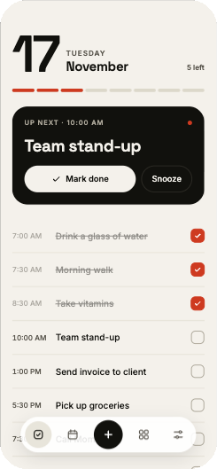

## 👋 Hi, I'm Lovish

B.Tech CSE graduate (2026). I build things end to end: LLM apps with
retrieval and structured outputs on the backend, and polished native apps
on the front. I care about products people actually open every day.

- 🔭 Now: building **Tick**, a daily reminders app for iOS
- 🧠 Also into: RAG, vector search, prompt engineering
- 💻 Core team, **CodeX Community**
- 📫 Best way to reach me: email or LinkedIn

---

## ⭐ Currently building: Tick

<table>
<tr>
<td width="40%" align="center">
  
</td>
<td valign="top">

### Tick: daily reminders
A simple reminders app for iOS. Plan your day, tick things off, and get a
gentle nudge until they're done.

`Swift` `SwiftUI`

**Status:** 🚧 In development, coming soon to the App Store

</td>
</tr>
</table>

---

## 🚀 More projects

<table>
<tr>
<td width="50%" valign="top">

### 🧠 [ResumeLens: AI Resume Analyzer](https://github.com/LovishAul1224/ResumeLensAI)
Parses PDF/DOCX resumes and uses Gemini to produce an ATS score,
section-by-section feedback and ranked fixes.

- Structured prompts that return consistent JSON
- Firebase Auth + history across resume versions
- Deployed on Vercel + Render

`React` `FastAPI` `Gemini` `Firebase` `Tailwind`

</td>
<td width="50%" valign="top">

### 🤖 [Ragify: Production RAG System](https://github.com/LovishAul1224/Ragify)
Ask questions about your PDFs with semantic search, similarity-threshold
filtering and an optional web-search fallback.

- Recursive chunking + Sentence-Transformer embeddings
- ChromaDB retrieval through LangChain, OpenRouter LLMs
- FastAPI backend, Streamlit UI

`Python` `LangChain` `ChromaDB` `FastAPI` `Streamlit`

</td>
</tr>
</table>

---

## 🛠️ Tech I use most

| | |
|---|---|
| **Mobile** |    |
| **AI / LLM** |     |
| **Web** |     |
| **Tools** |    |

Also: Java, JavaScript, Pandas, NumPy, scikit-learn, Tailwind, Express.

---

## 🏆 Highlights

- 🎓 **Supervised ML: Regression & Classification**, DeepLearning.AI × Stanford
- 🌐 **Generative AI Workshop**, Cognizance '25, IIT Roorkee
- 💻 **Javathon**, Alpha Tech quiz competition

Open to junior / new-grad roles in iOS and AI engineering. Say hi 👋

